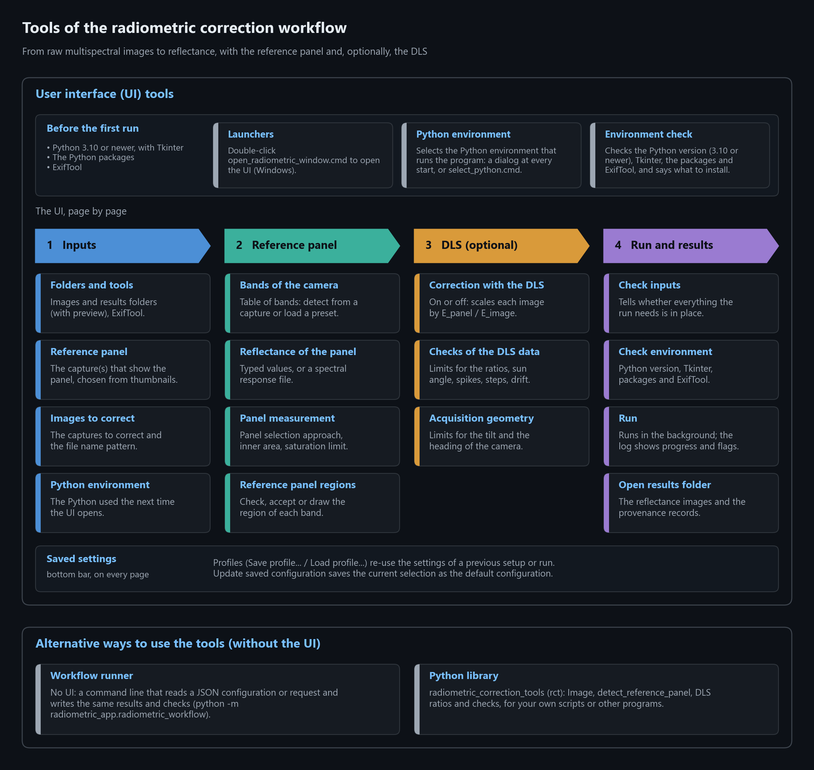
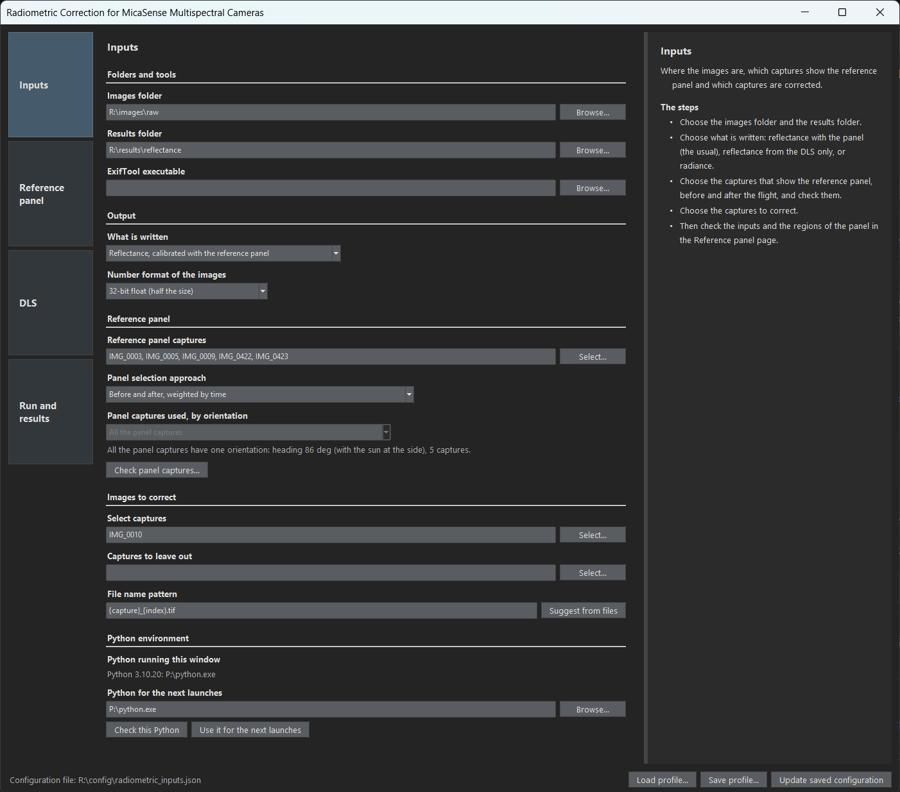

# Radiometric Correction for MicaSense Multispectral Cameras

&emsp;&emsp;This Python module provides a simplified alternative for converting raw images from MicaSense multispectral cameras into radiance or reflectance, using the reference panel and, optionally, the Downwelling Light Sensor (DLS) data to correct changes in illumination. It was written for the RedEdge-P and tested only with it (see [What has been tested](#what-has-been-tested)). It can be used through a user interface (UI), opened with a launcher on Windows, from the command line (the workflow runner) or as a Python library.

**Contents**

- [What has been tested](#what-has-been-tested)
- [Quick start](#quick-start)
- [Documentation](#documentation)
  - [Installing and launching](docs/installation.md)
  - [The user interface (UI)](docs/user-interface.md)
  - [The reference panel: reflectance and two panel captures](docs/reference-panel.md)
  - [Checking, accepting and drawing the panel regions](docs/panel-regions.md)
  - [Optional DLS correction](docs/dls-correction.md)
  - [How the reflectance is calculated](docs/calculation.md)
  - [Python library and workflow runner](docs/python-and-command-line.md)
  - [Other cameras and other numbers of bands](docs/other-cameras.md)
  - [Development notes](docs/development.md)
- [Background and credits](#background-and-credits)

  

## What has been tested

&emsp;&emsp;The program is prepared for other MicaSense cameras (RedEdge-M/MX, Altum, Altum-PT, dual-camera systems): the bands, the file names and the bands that are left out are configurable, and the bands can be read from the images themselves (see [Other cameras](docs/other-cameras.md)). For now, however, it has been tested **only with images of the MicaSense RedEdge-P**. The presets of the other models come from the documentation of the manufacturer, not from images, and cameras of other makers (for example Sentera) have not been tried. Use "Detect from capture" and compare the result with your own data before relying on them.

## Quick start

1. **Install** Python 3.10 or newer (with Tkinter) and, in a dedicated environment, the packages of `requirements.txt` (or run `conda env create -f environment.yml`), plus ExifTool, a separate program that reads the metadata of the images. On Windows, the QR code reader (pyzbar) also needs the Microsoft Visual C++ 2013 Redistributable (x64). The details, and what to check on a new computer, are in [Installing and launching](docs/installation.md).
2. **Open the UI**: double-click `open_radiometric_window.cmd` (Windows) or run `python -m radiometric_app window --root .` in the project folder. It asks which Python to use, checks the packages and ExifTool, and opens.
3. **Correct the example images** in `images/raw`: `IMG_0005` shows the reference panel, `IMG_0010` is the capture to correct and `IMG_0422` is a second panel capture, taken after the flight (the example images are three captures of a longer flight; the complete flight is not included). Go through the pages of the UI, described in [The user interface](docs/user-interface.md):
   - *Inputs*: the images folder, the results folder, the capture that shows the panel and the captures to correct.
   - *Reference panel*: the reflectance of the panel (typed, or computed from its spectral response file; the one of the example panel is in `reference_panel_spectral_response`), then "Check / draw panel regions..." to accept the region of the panel in each band.
   - *DLS* (optional): corrects the changes in illumination between the panel capture and each image.
   - *Run and results*: "Check inputs", then "Run".
4. **Read the results** in the results folder: a reflectance image (32-bit float values) for each band, with the name of its source file (`IMG_0010_3.tif` is the Red band before and after the correction), a `<capture>_provenance.json` for each capture with what was used to make it, and `radiometric_result.json` with the status of the run, the flags of the checks and the settings.

  

&emsp;&emsp;The same steps run without the UI, with the [workflow runner](docs/python-and-command-line.md#workflow-runner-no-user-interface) (a command line that reads a JSON configuration) or with the [Python library](docs/python-and-command-line.md#example-raw-images-to-reflectance-with-the-python-library).

## Documentation

| Page | What is in it |
|---|---|
| [Installing and launching](docs/installation.md) | What the program needs (Python, packages, ExifTool), choosing the Python, the check of the computer and the Windows launchers |
| [The user interface (UI)](docs/user-interface.md) | The four pages with screenshots, the saved settings (configuration and profiles) and where things are saved |
| [The reference panel](docs/reference-panel.md) | The reflectance of the panel, typed or computed from its spectral response file; one or two panel captures and how they are combined (by time or by illumination) |
| [Panel regions](docs/panel-regions.md) | The tool that checks, accepts or draws the region of the panel in each band |
| [Optional DLS correction](docs/dls-correction.md) | What the DLS ratio is, the checks of the DLS data and of the geometry, how the flags of a run are counted and the summary at its end |
| [How the reflectance is calculated](docs/calculation.md) | The steps from the raw values to radiance (dark level, vignetting, row gradient, scale) and to reflectance, and the geometry of the images |
| [Python library and workflow runner](docs/python-and-command-line.md) | The example in Python, the checks and the calibration record, and the command line |
| [Other cameras](docs/other-cameras.md) | The band table, detecting the bands from a capture, camera presets, file names, and what the program assumes about the camera |
| [Development notes](docs/development.md) | Project layout, how the UI is built and the tests |

## Background and credits

&emsp;&emsp;All functions are derived from the original [MicaSense image processing repository](https://github.com/micasense/imageprocessing) but have been streamlined to mitigate issues caused by Exif metadata inconsistencies. These issues were encountered while pre-processing images captured with the camera firmware v1.4.5 in preparation for geometric correction using photogrammetry software.

&emsp;&emsp;For more details about the steps required for pre-processing MicaSense multispectral images see the tutorials (e.g. ['Tutorial 1'](https://github.com/micasense/imageprocessing/blob/master/MicaSense%20Image%20Processing%20Tutorial%201.ipynb)) provided by MicaSense in their repository.

