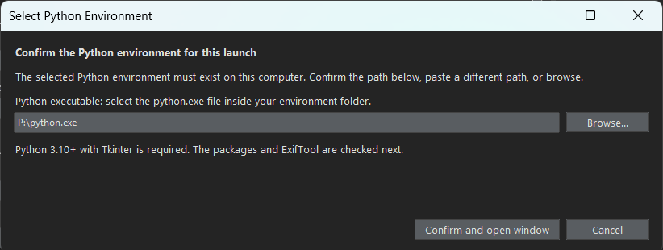

# Installing and launching

[Back to the README](../README.md)

&emsp;&emsp;What the program needs, how to choose the Python it runs with, how the computer is checked and the launchers (Windows).

## What the program needs

1. **Python 3.10 or newer, with Tkinter**, which the user interface uses. The Python of python.org and conda have it (python.org: keep "tcl/tk and IDLE" selected; Linux: `sudo apt install python3-tk`). The launchers need Windows 10 or 11; the program itself is plain Python.
2. **The Python packages** of `requirements.txt`: numpy, opencv-python, pillow, tifffile, matplotlib, scikit-image, shapely, pyzbar and PyExifTool (the file has the versions it was tested with, on Python 3.10.20 and Windows). Install them in a **dedicated environment**, not in the system Python. The program never installs anything: when a package is missing it says which and how, and stops. In a terminal, in the project folder:
   - conda: `conda env create -f environment.yml` (the environment is called `radiometric`; the file was checked by solving it with conda-forge, but the environment has not yet been created from it on another computer);
   - or a virtual environment: `python -m venv .venv`, then `.venv\Scripts\python.exe -m pip install -r requirements.txt`.

   Then choose the `python.exe` of that environment (see [Choosing the Python](#choosing-the-python)). Two packages need a note:
   - **pyzbar**, which reads the QR code of the panel, needs the zbar library. On **Windows** the package brings it, but the library needs the *Microsoft Visual C++ 2013 Redistributable (x64)*, which a new Windows often lacks. Without it the check says "pyzbar: broken" with "Could not find module '...libzbar-64.dll' (or one of its dependencies)". Install the runtime with `winget install Microsoft.VCRedist.2013.x64` (or download `vcredist_x64.exe` from Microsoft) and check again. On macOS install zbar with `brew install zbar`, and on Linux with `sudo apt install libzbar0`.
   - **OpenCV in a conda environment:** `environment.yml` installs pyzbar with pip inside the environment, because conda-forge has no Windows build of zbar (do not use `conda install pyzbar`, which gives an older version). Do not run `pip install -r requirements.txt` in an environment made from `environment.yml`: pip does not see conda's OpenCV under the name `opencv-python` and would install a second one on top of it. To check OpenCV use `python -c "import cv2; print(cv2.__version__)"`. The version is kept below 5, the range that was tested.
3. **ExifTool**, the program (not a Python package): see [ExifTool](#exiftool). Without it the UI opens but nothing can be read from the images.

## ExifTool

&emsp;&emsp;The metadata (bands, panel QR code, DLS irradiance) is read with ExifTool, a separate program, through the Python package PyExifTool (`pip install PyExifTool`; both are needed). On Windows, download the "Windows Executable" from [exiftool.org](https://exiftool.org/), rename `exiftool(-k).exe` to `exiftool.exe` and keep it next to its `exiftool_files` folder. The program is looked for in this order: the "ExifTool executable" field of the UI (`INPUTS.exiftool_path`), the environment variable `exiftoolpath` and the system PATH (it is enough that `exiftool -ver` works in a terminal). The field is only needed when ExifTool is not found by itself. The UI says in the help column what it found, and "Check inputs" and the workflow runner report it as a problem when it is missing.

## Choosing the Python

&emsp;&emsp;The program runs with the Python that you choose, which should be the dedicated environment above. The choice is kept in `config/python_environment.json` (not kept in git) and can be made or changed in three ways:

- `launchers/select_python.cmd` (Windows): a dialog asks for the `python.exe`, checks that it is Python 3.10 or newer with Tkinter, saves it and lists what else is missing. The other launchers use the saved choice and open the same dialog when there is none, or when the saved Python no longer exists.
- **The UI asks every time it starts.** The dialog "Select Python Environment" proposes the saved Python (or the one that is running) and you confirm it, paste another path or browse. "Confirm and open window" tests the Python, saves it and, if it is not the one that is running, starts the UI again with it. A Python that does not work is explained and not saved. `--skip-python-dialog`, or the environment variable `RADIOMETRIC_PYTHON_CONFIRMED=1`, skips the dialog (for example to run `python -m radiometric_app window` from a script).
- **The "Python environment" section of the Inputs page** of the UI (see [the user interface](user-interface.md#page-1-inputs)) checks a Python and saves it for the next launches.

## The check of the computer

&emsp;&emsp;The check (`radiometric_app/environment.py`, which uses only standard Python libraries, so it works before anything is installed) lists the Python and its path, Tkinter, each package with its version and ExifTool with its version and how it was found, and what to install for each thing that is missing (one `pip install` command for all the packages). It is used in four places:

- Before the UI or the panel tool opens (what the launchers run): when something is missing a message says what and how to install it, and nothing is opened; when only ExifTool is missing it asks whether to open the program anyway.
- The button "Check environment" on the "Run and results" page, which also imports every package, so that a broken one shows.
- `launchers/check_environment.cmd` or `python -m radiometric_app check [--deep] [--json] [--quiet] [--root folder]`: the same list in a terminal, with exit code 0 when all is in place and 1 when not (`--deep` imports every package, `--json` gives the result for other programs).
- From Python: `environment.check_environment()` returns one dictionary per thing, and `environment.install_text()` writes the instructions.

## Launchers (Windows)

&emsp;&emsp;Double-click `open_radiometric_window.cmd`, in the project folder, to open the UI; the other files are in the `launchers` folder. They use the Python chosen as described in [Choosing the Python](#choosing-the-python) and the project folder as `--root`, so the relative paths of the configuration (for example `images/raw`) are resolved from there.

- `open_radiometric_window.cmd`: the UI, without a console.
- `launchers/open_radiometric_window_debug.cmd`: the same UI with the console kept open, to see messages and error traces.
- `launchers/open_panel_selector.cmd`: only the tool to draw the panel regions, using `config/radiometric_inputs.json` if it exists, otherwise the defaults. Extra arguments are passed on (for example `--capture IMG_0005`).
- `launchers/select_python.cmd`: choose the `python.exe` and check it.
- `launchers/check_environment.cmd`: list the Python, Tkinter, the packages with their versions and ExifTool, and what to install.
- `launchers/_python.cmd`: used by the others to find the Python; it is not run by itself.

