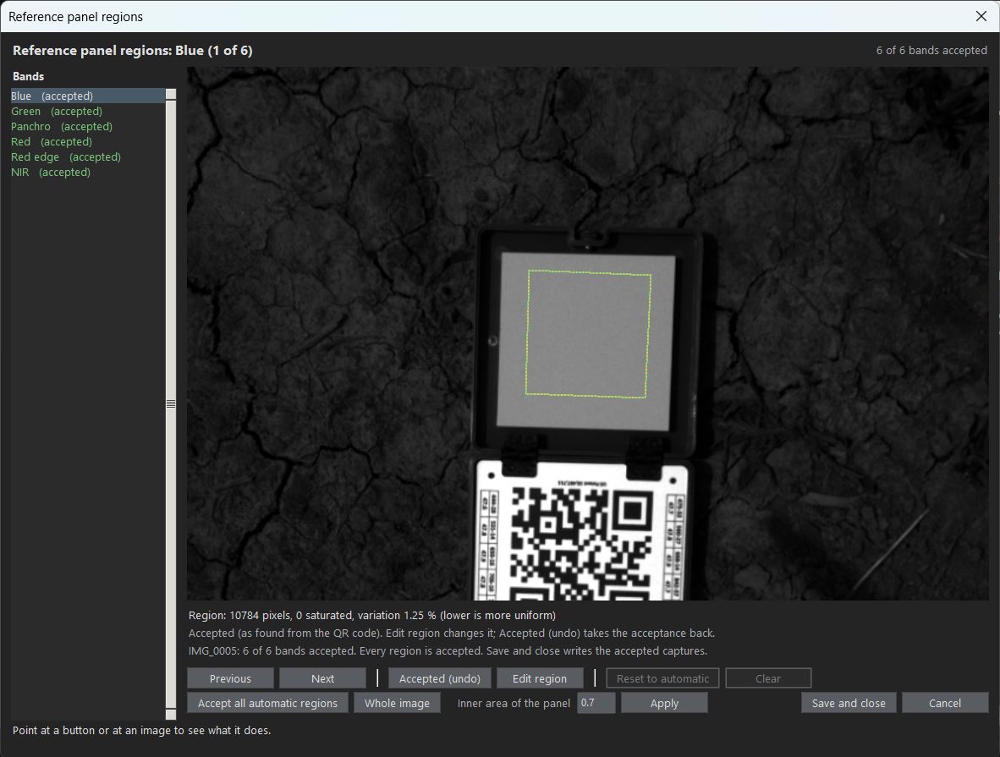

# Checking, accepting and drawing the panel regions

[Back to the README](../README.md)

&emsp;&emsp;The panel region of each band can be checked, accepted and, when it is wrong or the QR code cannot be read, drawn with the panel regions tool (`radiometric_app/panel_selector.py`). Open it with "Check / draw panel regions..." on the Reference panel page, or with `launchers/open_panel_selector.cmd` (`python -m radiometric_app.panel_selector --config config/radiometric_inputs.json --root <folder>`). The tool reads the panel captures chosen on the Inputs page, so "Check inputs" (next to the button) checks the folders, the panel capture and the bands first, and the tool does not open while there are problems. The file of the regions (`PANEL.manual_regions_file`, by default `panel_regions.json` in the results folder) does not have to exist yet: "Save and close" creates it, but a run needs it to exist.

- **One band at a time.** The bands are listed on the left, each marked as accepted, to accept or without a region, and the selected band is shown close up around the panel ("Whole image" shows all of it). The region found from the QR code is drawn in yellow (dashed), the accepted or saved one in green and the proposed one in cyan. Below the image are the pixels, the saturated pixels and the variation (std / mean; lower is more uniform) inside the region. "Accept" (Enter) takes the region as it is shown and goes to the next band that is not accepted (pressing it again takes the acceptance back); "Accept all automatic regions" accepts the QR code regions of all the bands at once. The regions saved before are shown as accepted.
- **Inner area of the panel.** `PANEL.percent_inner_area` is the central part of the panel that is measured, without its edge. It can be changed in the tool ("Inner area of the panel"): the regions accepted as found from the QR code go back to "to accept" with the new value, and the drawn or edited regions stay. "Save and close" copies the value to the UI and saves the configuration. A band whose region was accepted or drawn uses that region whatever the inner area says.
- **Every band must be accepted.** The region used for the panel is always one that you saw and confirmed. "Save and close" is available when all the bands of the panel captures are accepted, and writes the polygon of every band with where it came from (`accepted_automatic` or `edited`). Nothing is saved if the tool is cancelled.
- **Drawing.** "Edit region" (E) turns the drawing on for the band, starting from the region shown: a click adds a vertex (on an edge it inserts one), dragging moves a vertex and a right click removes it; the wheel zooms and the middle button drags the image. "Confirm edit" (Enter) accepts the polygon and goes to the next band that is not accepted; "Discard edit" (Esc) leaves the drawing without accepting what was changed. "Reset to automatic" (R), "Clear" (C) and Backspace (last vertex) work only while editing; Left/Right change the band (what was not confirmed is lost).
- **Captures.** The tool opens the panel captures only (the first and, when there is one, the one after the flight). The "Capture" selector (top right) switches between them and shows how many bands of each are accepted.
- **Hints.** What each element does is shown at the bottom of the tool while the mouse is over it.
- **In a run.** A band that has a region in the file uses it (no QR code is needed); the others are detected from the QR code. The panel audit and the provenance record say, for each band, whether the region was `automatic` or `manual` and its `region_origin`.
- From Python: `rct.Image.detect_reference_panel(levels, percent_inner_area, manual_bounds=polygon, region_origin=origin)` and `panel_selector.select_panel_regions(images, saved, saved_origins=origins)`, which returns the accepted polygons as a dictionary (a `SelectionResults`, with the `percent_inner_area` that the tool was left with) whose items have an `origins` attribute.

