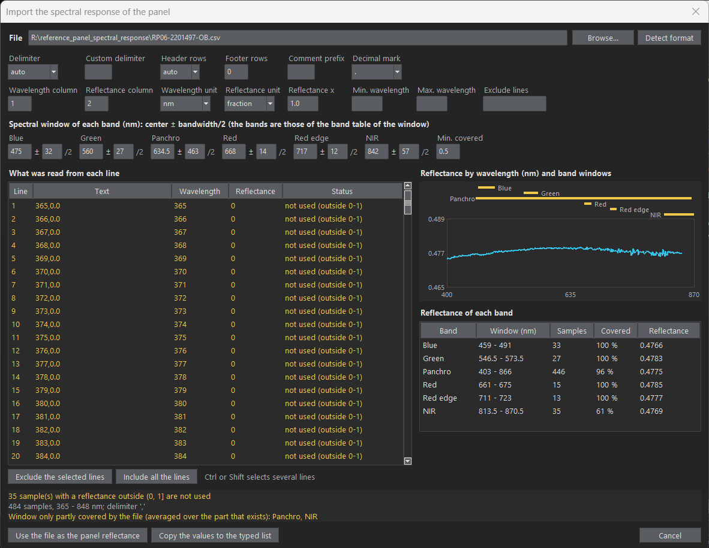

# The reference panel: reflectance and two panel captures

[Back to the README](../README.md)

## Panel reflectance from its spectral response file

Instead of typing the reflectance of each band, it can be computed from the spectral response of the panel, a .csv file with the reflectance by wavelength (```PANEL.reflectance_source``` = ```spectral_file```, ```PANEL.spectral_file```). The reflectance of a band is the mean of the curve over its spectral window, ```PANEL.band_center_wavelengths``` +/- ```PANEL.band_bandwidths``` / 2 (the band table of the window; the defaults are those of the RedEdge-P bands). The weighting is uniform, an approximation of the real spectral response of the filters: with the example panel it gives Blue 0.4766, Green 0.4783, Red 0.4785, Red edge 0.4777, NIR 0.4769 and Panchro 0.4775, against the 0.477, 0.478, 0.478, 0.478, 0.477 and 0.479 printed on the panel.

- **Format.** The file is read with the format in the ```PANEL.spectral_*``` keys: delimiter (```auto```, ```comma```, ```semicolon```, ```tab```, ```space``` or ```custom``` with one or more characters), header rows to skip (```auto``` skips the rows at the start that are not numbers, or a number), footer rows to skip, a comment prefix (such as ```#```), lines to exclude (```5, 10-12```), the smallest and largest wavelength used, the wavelength and reflectance columns, the wavelength unit (```nm``` or ```um```), the reflectance unit (```fraction``` or ```percent```), a reflectance multiplier (applied after the unit, for example 0.001) and the decimal mark (point or comma). In the dialog, lines can also be excluded by selecting them in the table.
- **Samples that are not used.** A reflectance outside (0, 1] (the example file has zeros below 400 nm) is not used. A window that reaches beyond the end of the file (the NIR window of the example, up to 870 nm, against a file that ends at 848 nm) is averaged over the part that exists. ```PANEL.spectral_min_coverage``` (0.5 by default) is the smallest part of a window that must have samples; every band below it is listed in the error.
- **In the window.** "Browse..." on the Reference panel page chooses the file and opens a dialog on it, with its format already detected (the file that is already the source keeps the format that was saved with it; "Preview and format..." opens the same dialog for it without choosing a file). The path and the format are applied together, only when one of the two buttons at the bottom is pressed, so cancelling leaves everything as it was. The dialog shows what was read from each line (header rows, rows with errors and unused samples are marked), the curve with the window of each band, and the reflectance, samples and covered part of each band, updated while the options are changed. "Detect format" guesses the delimiter, decimal mark, units and header rows. The windows and the minimum coverage can be edited there. Then "Use the file as the panel reflectance" fills the keys and makes the file the source, or "Copy the values to the typed list" only copies the computed numbers to the typed values. Only the controls of the chosen source can be edited on the page.
- **Record.** The result file and the provenance record keep the reflectance used for each band, the file, its SHA-256, and the samples and covered part of the window of each band (the format and the windows are in the configuration, which is saved too).
- From Python: ```panel_spectrum.load_spectrum(path, format)``` and ```panel_spectrum.band_reflectances(spectrum, windows, min_coverage)```; ```radiometric_workflow.panel_reflectance_levels(config, root)``` gives the levels that the workflow uses.



## Two panel captures (before and after the flight)

A second panel capture (```INPUTS.reference_panel_capture_after```) is always compared with the first one (the panel factor of every band, and the DLS irradiance relative to the irradiance estimated from the panel, must not change more than ```CHECKS.panel_drift_tolerance```). ```PANEL.panels_used``` says whether it also calibrates the images:

- ```first``` (default): only the first panel is used; the second is only compared.
- ```last```: only the second panel, the one after the flight, calibrates the images; the first is only compared with it (it needs a second panel capture).
- ```mean```: the two panels weigh the same (0.5 each).
- ```interpolate_time```: each image is weighted by its time between the two panel captures, from ```EXIF:DateTimeOriginal``` (0 at the first panel, 1 at the second; an image outside them uses the nearest panel; two panels taken at the same time weigh 0.5 each). It needs that tag in the images of the capture and of both panels.
- ```nearest_time```: each image uses, entirely, the panel that was captured closest in time to it (the first one if both are equally close or were taken at the same time). It needs the same time tags as ```interpolate_time```.
- ```nearest_illumination```: each image uses, entirely, the panel whose light was the most like its own (the first one if both are equally like it). The light of a capture is its DLS irradiance in every band (```XMP:HorizontalIrradiance```, which is the level of the light and how it is spread over the bands), and how different two lights are is ```rct.illumination_distance()```: the root mean square over the bands of the natural logarithm of the ratio of the irradiances (0.1 is about 10 %; 0 is the same light). It needs the DLS data in the images and in both panel captures, and ```CORRECTION.use_dls``` on: the two choices by illumination ("Nearest panel in light (uses the DLS)" and "Both panels, weighted by light (uses the DLS)") are in the list of the window, and choosing one turns "Correct illumination changes with the DLS" on (the status line says so); turning the correction off while one of them is chosen goes back to ```first``` and says so, and the check of the inputs and a run refuse them without the correction. The names in the list are descriptions of the values that are saved (```first```, ```last```, ```mean```, ```interpolate_time```, ```nearest_time```, ```nearest_illumination```, ```interpolate_illumination```).
- ```interpolate_illumination```: the same comparison, but both panels are used, each weighted by 1 / distance squared (```rct.ILLUMINATION_POWER```): ```w = d1^2 / (d1^2 + d2^2)``` is the weight of the second panel, where d1 and d2 are the distances of the light of the image to that of the first and of the second panel. A panel with the light of the image counts alone, equal distances weigh 0.5, and the weight changes smoothly with the light, so neighbouring images do not jump between two panels that disagree (the step that ```nearest_illumination``` can make where the choice changes, as large as the disagreement of the two panels).

The capture is compared as a whole, so the same weight is used in every band, which keeps the relation between the bands. In both modes the distances of each capture are written in the result file (```light_difference``` of the capture) and in its provenance record (```checks.panel_light_difference```), and a capture whose light is more different than ```CHECKS.panel_illumination_tolerance``` (0.15, about 15 %) from the nearest panel is flagged, counted like the other flags ("Light more than 15 % different from the nearest panel capture in N of M captures: ..."): there is no panel in light like its own and another panel capture would help. The summary at the end of the run says how many captures used the first panel alone, the second alone and both.

In the example flight (a first panel at 13:26 UTC and a last one at 13:48 UTC) the irradiance rises by 32 to 35 % between the two, and most of the 409 captures are close to the light of the last panel; with ```nearest_illumination``` the first panel is chosen for about 40 of them (the first two captures, a few at ```IMG_0087```-```IMG_0092``` and a stretch from ```IMG_0256``` with a drop of the irradiance), and ```nearest_time``` would have chosen it for the whole first half of the flight.

Without the DLS the panel factors are averaged with these weights. With the DLS what is averaged is the factor times the irradiance of each panel, which is a constant of the camera that does not depend on the light (the two panels should agree on it), and the result is expressed for the irradiance of the first panel, which the DLS ratio refers to: ```factor = ((1 - w) f1 E1 + w f2 E2) / E1```. The weight and the factor that was used are written in the provenance record of each band (```second_panel_weight```, ```effective_factor```) and the weight of each capture in the result file. The regions of both panel captures are drawn and accepted in the same tool, and both must be accepted before saving.

With the DLS the choice of "the reference panel" does not exist as such: the product factor x irradiance of a panel is the same constant wherever the panel was photographed, so what matters is which panels contribute to it (```first```, the nearest, or a mean), and the result is the same whatever panel the irradiance ratio is written relative to. The two panels agree on that constant when the DLS followed the light seen by the camera; ```CHECKS.panel_drift_tolerance``` flags it when they do not. MicaSense advises taking the panel image that best represents the average illumination of the flight when only one is used.

How Metashape combines several panel images, and what its sun sensor option is referenced to, is not described in its manual (2.1) or in the forum threads of Agisoft that were read for this project; a Metashape workflow gives all the panel captures of the chunk to ```chunk.calibrateReflectance(use_reflectance_panels, use_sun_sensor)``` and cannot choose among them. Do not assume that it averages or follows the time: test it with panels of known different factors before relying on one behaviour.
