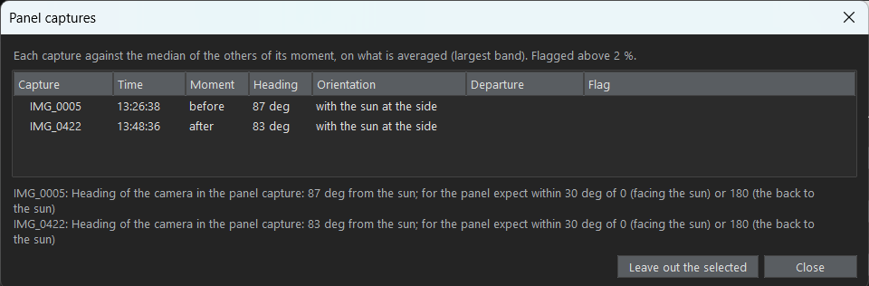

# The reference panel: reflectance and two panel captures

[Back to the README](../README.md)

<div align="justify">

## Panel reflectance from its spectral response file

&emsp;&emsp;Instead of typing the reflectance of each band, it can be computed from the spectral response of the panel: a .csv file with the reflectance by wavelength (`PANEL.reflectance_source` = `spectral_file`, `PANEL.spectral_file`). MicaSense provides this file for its panels (together with the values printed on the panel; it can also be requested from their technical support). The reflectance of a band is the mean of the curve over its spectral window, the band center +/- half of its bandwidth (from the band table of the UI). The weighting is uniform, an approximation of the real spectral response of the filters. With the example panel it gives:

| Band | Blue | Green | Red | Red edge | NIR | Panchro |
|---|---|---|---|---|---|---|
| Computed from the file | 0.4766 | 0.4783 | 0.4785 | 0.4777 | 0.4769 | 0.4775 |
| Printed on the panel | 0.477 | 0.478 | 0.478 | 0.478 | 0.477 | 0.479 |

- **Format.** The file is read with the format given in the `PANEL.spectral_*` keys: delimiter, header and footer rows to skip, comment prefix, lines to exclude, range of wavelengths, columns, units (`nm` or `um`; `fraction` or `percent`), a multiplier and the decimal mark. The UI detects them (see below).
- **Samples that are not used.** A reflectance outside (0, 1] (the example file has zeros below 400 nm) is not used. A band window that goes beyond the end of the file (the NIR window of the example, up to 870 nm, against a file that ends at 848 nm) is averaged over the part that exists, as long as at least `PANEL.spectral_min_coverage` (0.5 by default) of it has samples; otherwise the band is listed in the error.
- **In the UI.** "Browse..." on the Reference panel page chooses the file and opens a dialog with its format already detected ("Detect format" guesses it again). The dialog shows what was read from each line, the curve with the window of each band, and the reflectance, samples and covered part of each band, updated as the options change. "Use the file as the panel reflectance" makes the file the source; "Copy the values to the typed list" only copies the computed numbers. Cancelling leaves everything as it was, and "Preview and format..." reopens the dialog for the file already chosen.
- **Record.** The result file and the provenance record keep the reflectance used for each band, the file with its **SHA-256** and the samples and covered part of the window of each band. SHA-256 is a checksum: a 64-character fingerprint calculated from the content of the file, which changes if the file changes by even one byte, so the record shows exactly which file was used.
- From Python: `panel_spectrum.load_spectrum(path, format)` and `panel_spectrum.band_reflectances(spectrum, windows, min_coverage)`; `radiometric_workflow.panel_reflectance_levels(config, root)` gives the levels that the workflow uses.


## Two panel captures (before and after the flight)

&emsp;&emsp;All the panel captures of a flight go in one field, "Reference panel captures" (`INPUTS.reference_panel_capture`, names separated by commas). The program sorts them by their time (`EXIF:DateTimeOriginal`): those taken before the first capture to correct are the panel **before** the flight, and those taken after the last one are the panel **after** it (one taken during the flight goes to the closer end). Configurations of earlier versions, which had a second field for the panel after the flight (`INPUTS.reference_panel_capture_after`), still work: its captures are after the flight whatever their time, and the UI moves them to the one field.

&emsp;&emsp;The panel after the flight is always compared with the one before: the panel factor of every band, and the DLS irradiance relative to the irradiance estimated from the panel, must not change by more than `CHECKS.panel_drift_tolerance` (5 %), or a flag is raised. `PANEL.panels_used` (the "Panel selection approach" of the UI, next to the panel captures) says whether the panel after the flight also calibrates the images; with panel captures of one moment only, every approach uses them alone, and a flag says so:

- "Before the flight only" (`first`, default): only the panel captures before the flight calibrate the images; those after it are only compared.
- "After the flight only" (`last`): only the panel captures after the flight calibrate the images.
- "Average of before and after" (`mean`): the two moments weigh the same (0.5 each).
- "Before and after, weighted by time" (`interpolate_time`): each image is weighted by its time between the two moments (`EXIF:DateTimeOriginal`, the mean time of the captures of each moment): 0 at the moment before, 1 at the one after; an image outside them uses the nearest.
- "Before or after, the nearer in time" (`nearest_time`): each image uses, entirely, the moment closest in time to it (the one before if both are equally close).
- "Before or after, the nearer in light" (`nearest_illumination`, needs the DLS): each image uses, entirely, the moment whose light was the most like its own (the one before if both are equally like it).
- "Before and after, weighted by light" (`interpolate_illumination`, needs the DLS): both moments are used, weighted by how much their light resembles that of the image: the weight of the moment after the flight is `w = d1^2 / (d1^2 + d2^2)`, where `d1` and `d2` are the illumination distances (see below) from the image to the moments before and after. A moment with the light of the image counts alone, equal distances weigh 0.5, and the weight changes smoothly, so neighboring images do not jump between two moments that disagree (the step that `nearest_illumination` can make where its choice changes, as large as the disagreement of the two moments).
- "Closest single capture before and after each image, by time" (`adjacent_time`, as Metashape): of all the panel captures, only the last one taken before the image and the first one after it are used, weighted by time, without averaging; an image before the first or after the last uses the closest. With one capture in each moment it is the same as `interpolate_time`; with several, the others are not used (see [Metashape](#metashape)).

&emsp;&emsp;The example images include a panel capture taken after the flight, `IMG_0422`, to try these options (put `IMG_0005, IMG_0422` in the panel captures).

### The illumination distance

&emsp;&emsp;The light of a capture is its DLS irradiance in each band (`XMP:HorizontalIrradiance`), which carries both the level of the light and how it is spread over the bands. The distance between the light of two captures is calculated band by band: the natural logarithm of the ratio of the irradiances, then the root mean square over the bands:

```
distance = sqrt( mean over the bands of ( ln(E_capture / E_panel) )^2 )
```

&emsp;&emsp;A distance of 0 means the same light, and 0.1 is about a 10 % difference (if the irradiance of every band is 10 % higher than at the panel, each logarithm is ln(1.1) = 0.095 and so is the distance). The capture is compared as a whole, so the same weight is used in every band, which keeps the relation between the bands.

&emsp;&emsp;The options by illumination need the DLS data in the images and in both panel captures, and `CORRECTION.use_dls` on. In the UI, choosing one of them turns the DLS correction on, and turning it off again goes back to `first`; the check of the inputs and a run refuse them without the correction. The distances of each capture are written in the result file (`light_difference`) and in its provenance record (`checks.panel_light_difference`). A capture whose light differs by more than `CHECKS.panel_illumination_tolerance` (0.15, about 15 %) from the nearest panel is flagged, because no panel was taken in light like its own and another panel capture would help. The summary at the end of a run says how many captures used the panel before the flight alone, the one after it alone, and both.

### How the panels are combined

&emsp;&emsp;Without the DLS, the panel factors are averaged with these weights: `factor = (1 - w) f1 + w f2`, where `f1`, `f2` are the factors of the panel before and after the flight (each the mean of the captures of its moment) and `w` the weight of the panel after the flight. With the DLS, each panel is first brought to the light of the image with its own DLS ratio, and then the panels are averaged: `factor = (1 - w) f1 E1 / E + w f2 E2 / E`, where `E1`, `E2` are the irradiances of the panels and `E` that of the image. The image is multiplied by this factor (`rct.combine_panels`). The provenance record of each band lists the panels used, each with its weight, factor, DLS ratio and adjusted factor, and the factor applied (`factor_applied`); the result file has the weight of each capture. The regions of both panel captures are accepted in the same tool, and both must be accepted before saving.

### Several captures of one moment

&emsp;&emsp;Several photos of the panel are often taken one after the other, for example `IMG_0005, IMG_0006, IMG_0007` before the flight. The captures of one moment are averaged: the weight of the moment is shared equally among them, so one bad photo (a shadow, a tilted panel, a hand) counts less. The time of the moment is the mean of their times, and its light (for the options by illumination) the mean of their DLS irradiances.

&emsp;&emsp;How much the captures of one moment disagree is checked, band by band, on what is averaged: the panel factor without the DLS, and the panel factor x the DLS irradiance with it. With three or more captures, each one is compared with the median of its moment, and a capture that departs by more than `CHECKS.panel_capture_spread_tolerance` (0.02, 2 %) is flagged by name, so that it can be left out; with two, the one that is wrong cannot be told, and the spread of the pair (standard deviation / mean) is flagged instead. The spread and the departures are written in the result file (`panel.before.spread`, `panel.before.departures`). In the flight of the example, the six panel captures after the flight agree within 0.3 %, but in the seven before it the DLS irradiance rose by about 28 % in 20 seconds while the camera saw the panel change by about 4 %: with the DLS, those captures disagree by 9 %, a sign that the DLS was shaded or not yet stable: six of the seven are flagged, from IMG_0003 (-22 % from the median) to IMG_0009 (+7 %). Without the DLS four are flagged, by 2.2 to 2.7 %. Leave out the captures that disagree, or rely on the other moment.

&emsp;&emsp;"Check panel captures..." (Inputs page, under the panel captures) measures all of them without correcting anything and shows a table: the time, moment, heading and orientation of each capture, and how far it is from the other captures of its moment (the largest band), with the flagged ones in yellow. "Leave out the selected" removes the selected captures from the panel captures and adds them to the captures to leave out, so they are not corrected either.

<p align="center">
  
</p>

### Panel captures in different orientations

&emsp;&emsp;The panel can be photographed with the camera facing the sun, with its back to it or with the sun at its side, and the orientations can give different factors: the panel does not reflect the same light in every direction, and the shadow of the operator or of the aircraft falls differently. The orientation of each panel capture is read from its metadata, the heading of the camera (`XMP:Yaw`) against the direction of the sun (`XMP:SolarAzimuth`): 0 degrees facing the sun, 90 the sun at the side and 180 the back to the sun. The captures whose headings are within 20 degrees of each other are one orientation. "Panel captures used, by orientation" (`PANEL.panel_orientation`, next to the panel captures) offers the orientations found among the panel captures, with their headings and the number of captures:

- All the panel captures (`all`, the default): when one moment has captures of several orientations, they are averaged, and a flag says when an orientation differs from the one with the most captures by more than the spread limit (`panel.before.orientation_difference` in the result file).
- One orientation (its heading is saved, for example `30`): only the captures within 20 degrees of it are used, so that one protocol is followed. When none is left, the run stops and lists the headings found.

&emsp;&emsp;The orientation is only as good as `XMP:Yaw`. In the flights of this project each set of panel photos has one heading, for example 87 degrees for all seven before the 2023-02-02 flight, and 63 degrees before and 30 degrees after the 2024-02-08 flight; check the headings in "Check panel captures".

&emsp;&emsp;The DLS checks of each image compare it with the panel capture closest in time, in the moment that weighs most in its calibration.

### With the DLS, which panel is "the reference"?

&emsp;&emsp;A panel capture calibrates the camera for the light of that moment. Without the DLS this is only right while the light stays as it was, so the choice of panel (or of a mix of both) matters directly. With the DLS, each image is also scaled by the change in irradiance since the panel capture, so what a panel provides is the product of its factor and the irradiance measured at that moment, `f x E`. This product is a constant of the camera that does not depend on the light, so it should be the same for either panel. What matters is which panels contribute to the constant: the first, the nearest or a mean of both.

&emsp;&emsp;The panels before and after the flight agree on the constant when the DLS followed the light seen by the camera; when they do not (for example, a cloud or a tilted DLS), `CHECKS.panel_drift_tolerance` raises a flag. When only one panel capture is used, MicaSense advises taking the one that best represents the average illumination of the flight.

### The example flight

&emsp;&emsp;The example images are three captures of a longer flight of 411 captures, which is not included in the repository: the first panel (`IMG_0005`, 13:26 UTC), one capture to correct (`IMG_0010`) and the last panel (`IMG_0422`, 13:48 UTC). Over the whole flight (409 captures in between) the irradiance rises by 32 to 35 % between the two panels, and most captures are closer in light to the last panel. With `nearest_illumination` the first panel is chosen for about 40 of them (the first two captures, a few around `IMG_0087` to `IMG_0092` and a stretch from `IMG_0256`, where the irradiance drops), and `nearest_time` would have chosen it for the whole first half of the flight. These figures come from the complete flight and cannot be reproduced with the example images alone.

### Metashape

&emsp;&emsp;Metashape's manual does not say how several panel images are combined, so it was tested with Metashape Pro 2.3.1 (`chunk.calibrateReflectance`) on the flight of 2023-02-02, comparing the factor that Metashape gives to 24 band images (4 captures spread over the flight, 6 bands) with what each option of this program predicts:

| Panel captures in the chunk | What Metashape does | Option of this program that gives the same |
|---|---|---|
| One before and one after the flight (IMG_0005, IMG_0422) | Linear interpolation in time between the two (within 0.05 %) | "Before and after, weighted by time" (`interpolate_time`) |
| Seven before and six after (IMG_0003 to IMG_0009, IMG_0419 to IMG_0424) | Only the last capture before the image and the first one after it, interpolated in time; the other eleven do not change the result | "Closest single capture before and after each image, by time" (`adjacent_time`) with all of them, or `interpolate_time` with only IMG_0009 and IMG_0419 |

&emsp;&emsp;With the sun sensor, each of the two panel captures is first multiplied by `E_panel / E_image`, with `E` from `XMP:HorizontalIrradiance`, as this program does with the DLS correction (within 0.04 %). The other options differ from Metashape by 2 to 32 % in these images. The panel factors themselves are 0.6 % higher in Metashape than in this program, in every capture checked, which comes from the measurement of the panel (its region and reflectance value). Metashape relying on a single photo of each moment matters when the photos disagree: in this flight it uses IMG_0009, which departs by +7 % from the median of the captures before the flight when the DLS is used.

</div>
