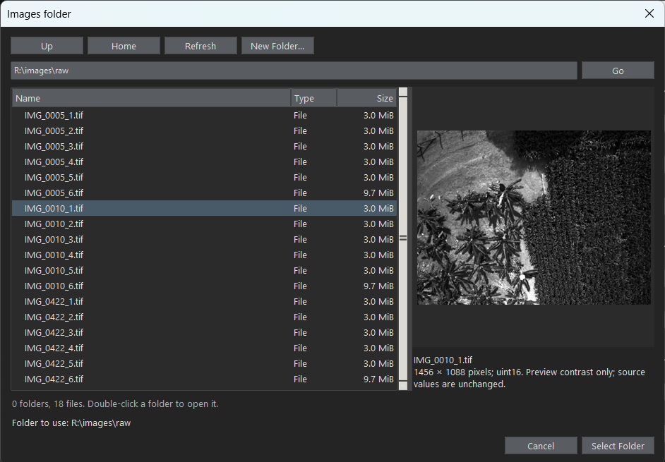
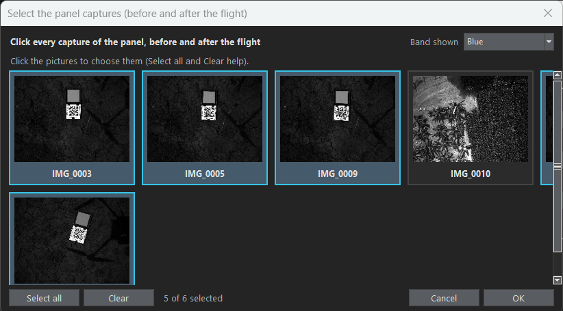
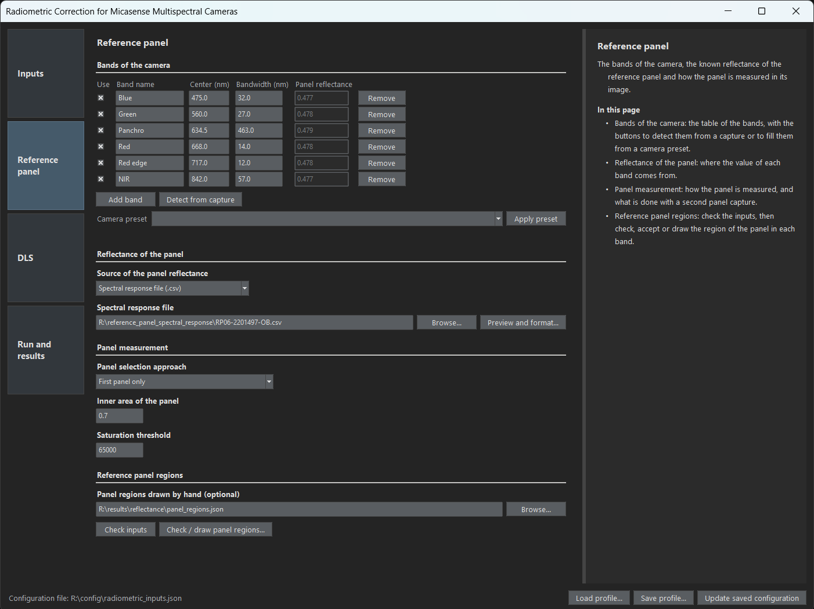
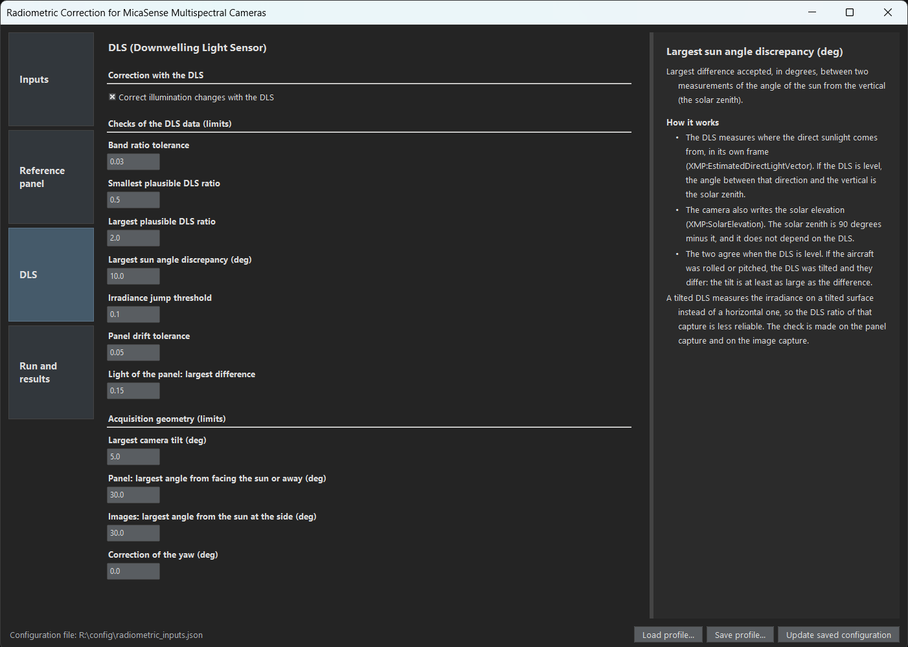
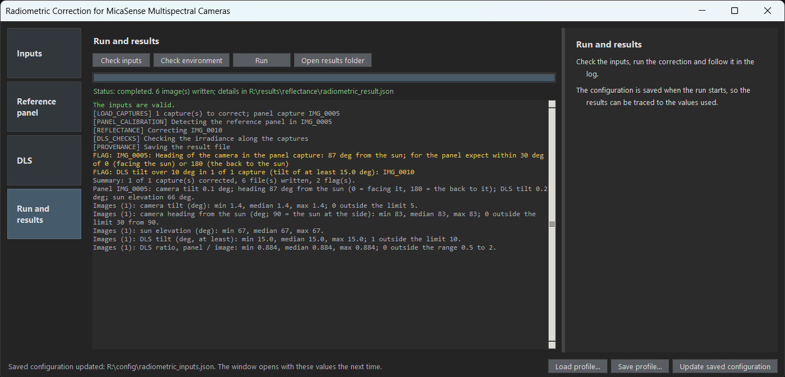

# The user interface (UI)

[Back to the README](../README.md)

<div align="justify">

&emsp;&emsp;The UI is the application that sets up and runs the correction without writing code (the alternatives are the [workflow runner and the Python library](python-and-command-line.md)). It has four pages, chosen with the tiles on the left, a help column on the right and a bottom bar with the saved settings. Open it with `open_radiometric_window.cmd` (see [Installing and launching](installation.md#launchers-windows)) or, from the project folder:

```
python -m radiometric_app.radiometric_window [--config config/radiometric_inputs.json] [--root <folder>]
```

&emsp;&emsp;The pictures below were taken on the example images, with the DLS on.

## Layout

&emsp;&emsp;The tiles on the left choose the page (Inputs, Reference panel, DLS, Run and results). The input fields in the center are the parameters that can be typed or selected, and the help column on the right explains the field under the pointer or with the keyboard focus. The column also shows information that depends on your data (for example, how the file name pattern reads the images folder or what the spectral file gives in each band), and a problem with a field (a pattern that matches nothing, a capture that is not in the folder) is written in red under it, only while it is wrong. The divider between the fields and the column can be dragged.

## Page 1: Inputs

&emsp;&emsp;Where the images are, which captures show the reference panel and which captures are corrected.


- **Folders and tools**: the images folder, the results folder and the ExifTool executable (only needed when it is not found by itself, see [ExifTool](installation.md#exiftool)). "Browse..." next to the folders opens a folder browser with a preview of the selected image, so the raw images of a flight can be recognized by looking at them (the preview is stretched between the 1 % and 99.5 % percentiles of the image to show dark images; the file is not changed).
- **Output**: what the images hold, reflectance calibrated with the reference panel (the default), reflectance from the DLS only or radiance (see [what is written](calculation.md#what-is-written)), and their number format, 32-bit float (the default, half the size) or 64-bit.
- **Reference panel**: the capture that shows the panel and, optionally, a second one taken after the flight (see [two panel captures](reference-panel.md#two-panel-captures-before-and-after-the-flight)); each can be several captures taken one after the other, which are averaged (see [several captures of one moment](reference-panel.md#several-captures-of-one-moment)). "Select..." opens a picker with one picture for each capture of the images folder, so the panel capture can be recognized by looking at it; a box chooses the band shown. The names can also be typed.
- **Images to correct**: "Select..." opens the same picker to choose the captures to correct (several, with "Select all" and "Clear"); the panel captures are not offered. When the field is empty, all the other captures of the folder are corrected, except the **captures to leave out** (for example photos of the panel that are not used, or photos taken on the ground), chosen with the same picker. The **file name pattern** says how the files of a capture are named (by default `{capture}_{index}.tif`, as in `IMG_0005_1.tif`); the help column shows how many files and captures it finds in the folder, and "Suggest from files" writes a pattern from the names. Other naming schemes are described in [Other cameras](other-cameras.md).
- **Python environment**: the Python that is running the UI and the one for the next launches (the field, with "Browse..."). "Check this Python" lists its version, whether it can open a window, the packages and ExifTool it has, and the `pip install` command for what is missing. "Use it for the next launches" tests it and saves it in `config/python_environment.json`; it is not part of the configuration or of the profiles. A running UI cannot change its own Python (see [Choosing the Python](installation.md#choosing-the-python)).

| The folder browser, with the picture of the selected image | The capture picker |
|---|---|
|  |  |

## Page 2: Reference panel

&emsp;&emsp;The bands of the camera, the known reflectance of the reference panel and how the panel is measured in its image.



- **Bands of the camera**: the table of the bands (name, center and bandwidth, panel reflectance), with buttons to add a band, to detect the bands from a capture and to fill them from a camera preset. See [Other cameras](other-cameras.md).
- **Reflectance of the panel**: the value of each band, typed in the table or computed from the spectral response file of the panel ("Browse..." chooses it and opens the import dialog; "Preview and format..." reopens it). See [Panel reflectance from its spectral response file](reference-panel.md#panel-reflectance-from-its-spectral-response-file).
- **Panel measurement**: the panel selection approach (which panel capture calibrates the images, see [two panel captures](reference-panel.md#two-panel-captures-before-and-after-the-flight)), the inner area of the panel that is measured and the saturation threshold.
- **Reference panel regions**: "Check inputs" tells whether the folders, the panel capture and the bands are right, and "Check / draw panel regions..." opens the tool in which the region of the panel in each band is checked, accepted or drawn (see [the panel regions tool](panel-regions.md)). The regions are kept in the file `PANEL.manual_regions_file`, by default `panel_regions.json` in the results folder.

## Page 3: DLS

&emsp;&emsp;The correction with the DLS, which is optional, and the limits of the checks of its data and of the geometry of the acquisition.



- **Correction with the DLS**: the box that turns the correction on. See [Optional DLS correction](dls-correction.md).
- **Checks of the DLS data (limits)**: the limits that raise a flag when the DLS data should not be trusted (the flags never change a result). See [Checks of the DLS data](dls-correction.md#checks-of-the-dls-data).
- **Acquisition geometry (limits)**: the limits for the tilt of the camera and its heading relative to the sun. See [Geometry of the acquisition](dls-correction.md#geometry-of-the-acquisition).

## Page 4: Run and results

&emsp;&emsp;The last page runs the workflow in the background, so the UI stays responsive.



- **Check inputs** lists every problem, without running anything.
- **Check environment** lists the Python, Tkinter, the packages with their versions and ExifTool of the computer and what to install (see [The check of the computer](installation.md#the-check-of-the-computer)).
- **Run** saves the configuration and shows the progress, the flags of the checks (counted by criterion, see [the flags of a run](dls-correction.md#the-flags-of-a-run-are-counted-by-criterion)), the errors, a summary and the result file.
- **Open results folder** opens the folder in the file explorer.

## Saved settings and where things are saved

&emsp;&emsp;The bottom bar is the same on every page. It has three buttons ("Load profile...", "Save profile..." and "Update saved configuration") and, at the left, the configuration file in use.

- **Configuration** (`config/radiometric_inputs.json`, or the file given with `--config`): the values that differ from the defaults. "Update saved configuration" and "Run" write it, so it is what was used in the last run, and the UI opens with it the next time.
- **Profiles** (`config/profiles/*.json`): "Save profile..." writes every value of the UI to a file (in `config/profiles` or anywhere else) and "Load profile..." replaces all the values with those of a file. A profile is complete, so it is the safer way to keep a setup for a camera or a flight. "Load profile..." also reads the `radiometric_result.json` or the provenance file of a past run, which brings back the settings of that run (the results folder is then that of the run, which the status line says: check it before running again). The command line takes them as well: `--config <results folder>/radiometric_result.json` repeats a run.
- **Panel regions** drawn by hand: `panel_regions.json` in the results folder, or the file in `PANEL.manual_regions_file`.
- **Results**: the images (reflectance or radiance), `<capture>_provenance.json` and `radiometric_result.json` in the results folder.
- **Python for the next launches**: `config/python_environment.json`.

</div>
